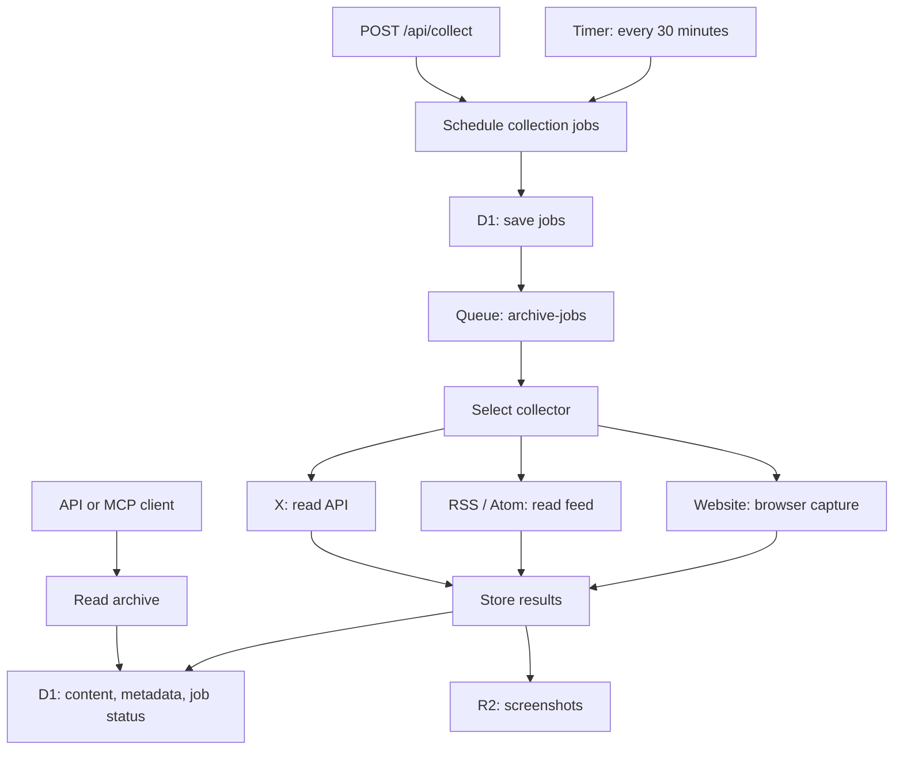

## One app, three entry points

`apps/worker` is the archive’s backend. It runs on Cloudflare Workers. It collects content, stores
it, and lets clients read it.



### 1. Schedule work

**`apps/worker/src/jobs/schedule.ts`**

```text
scheduleCollections
  read enabled sources from D1
  calculate the current 30-minute time slot
  create one job per source for that slot
    ignore an existing job with the same ID
  send up to 100 queued jobs to the queue
```

The timer and `POST /api/collect` use the same function. A manual request therefore **does not
force a new collection** if that source already has a job for the current time slot.

Jobs are saved before queue messages are sent. If sending fails, a later schedule run can send jobs
that still have `queued` status.

### 2. Collect and store

**`apps/worker/src/jobs/dispatch.ts`**

```text
queue message
  dispatchCollection
    skip missing or completed jobs
    load the enabled source
    set job status to running
    select collector
      website → page title, body text, viewport screenshot
      rss     → up to 200 feed entries; no article-page fetch
      twitter → latest 100 posts from a profile or List
    storeCollection
      write screenshots to R2
      insert items into D1, ignoring duplicates
      mark job completed in the same database batch
  acknowledge message
```

Collectors return data. They do not update archive or job state. **`storage/collection.ts` owns
those writes.**

On failure:

```text
collection fails
  record failed status and error in D1
  request queue retry after 60 seconds
  after configured retries → dead-letter queue
```

The queue is configured for one message per batch and one consumer at a time.

### 3. Read and manage the archive

All HTTP routes require:

```text
Authorization: Bearer <ARCHIVE_API_KEY>
```

| Route | Purpose |
|---|---|
| `GET /health` | Check service health |
| `GET /api/items` | Read archived items |
| `GET /api/collections` | Read collection records |
| `GET /api/jobs` | Read job status |
| `POST /api/collect` | Schedule collection |
| `/mcp` | Give an AI client access to archive tools |

The MCP tools are `search_items`, `get_recent_items`, `get_item`, `get_sources`, and `add_source`.
`get_sources` lists all source records, including disabled sources, in ID order. It returns each
source's ID, kind, URL, enabled state, and creation time. It does not collect content.
Collection itself does **not** use an LLM.

Pi connects over Streamable HTTP at `/mcp`. Its user configuration in `~/.pi/agent/mcp.json`
sets the `Authorization` header to `Bearer <YOUR_API_KEY>`, using the Worker's API key.
Keep this personal configuration out of source control. The Worker checks this key
before it passes requests to the MCP handler. This connection does not use OAuth.

See [Connect Pi to the archive](README.md#connect-pi-to-the-archive) for setup and connection checks.

## Where the parts live

```text
apps/worker/
├── wrangler.json          # Cloudflare resources, queue limits, timer
└── src/
    ├── index.ts           # Connects real handlers, collectors, and storage
    ├── worker.ts          # Routes HTTP, timer, and queue events
    ├── routes/            # HTTP handlers
    ├── mcp.ts             # Archive tools for AI clients
    ├── jobs/
    │   ├── schedule.ts    # Creates jobs and sends queue messages
    │   └── dispatch.ts    # Selects and runs a collector
    ├── collectors/        # Website, RSS, and X collection
    ├── browser/           # Page rendering and screenshot capture
    └── storage/           # Saves results and completes jobs
```

**Useful way to inspect it:** start with `GET /api/jobs`. It shows whether a problem is in
scheduling, collection, or completion, without first checking the archived content.
